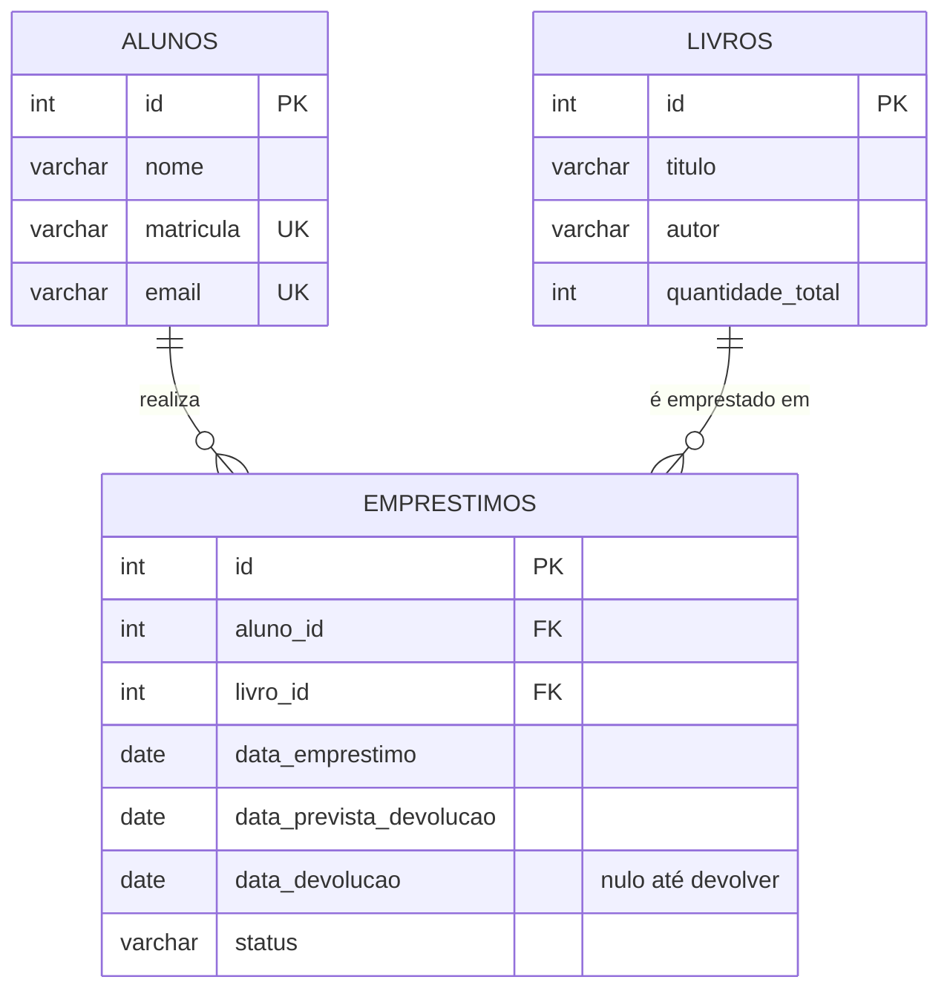
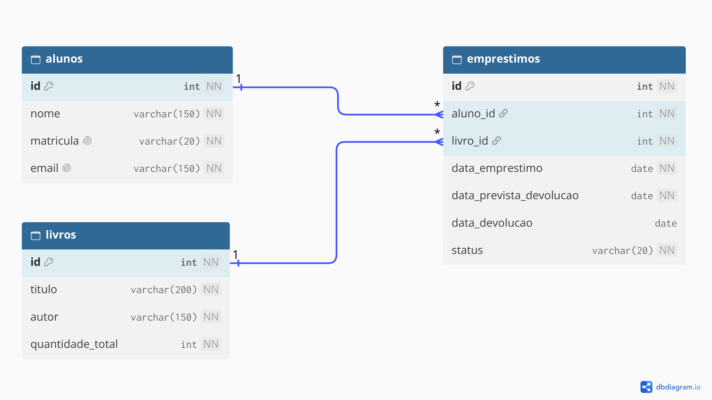

# API de Biblioteca Escolar

> Projeto Final de Backend — API REST  
> **Tema:** Educação e Aprendizado

## Integrantes

| Nome | Papel |
|---|---|
| Guilherme Rossa | Modelagem e organização do repositório |
| Gustavo Rossa | Camada de serviço e regras de negócio |
| Filipe | Controllers e endpoints |
| Gabriel | Banco de dados e validação |

## Problema

Quando os empréstimos são registrados em planilhas ou cadernos, fica mais difícil conferir quantos exemplares estão disponíveis, localizar o aluno responsável e identificar devoluções atrasadas.

## Domínio e aplicação

A API REST gerencia o acervo de uma biblioteca escolar. Ela permite cadastrar alunos e livros, consultar os registros e acompanhar empréstimos, devoluções e disponibilidade de exemplares.

## Tecnologias

- Java 21 e Spring Boot 4.2.0
- Spring Web MVC para as rotas HTTP e a comunicação em JSON
- Spring Data JPA para persistência e Jakarta Validation para os dados de entrada
- H2 em memória para execução local
- Maven Wrapper para compilar e executar o projeto

## Diagrama das entidades





> Diagrama gerado no dbdiagram.io.

## Entidades e relacionamentos

- **Aluno** representa quem pega livros emprestados. A matrícula e o e-mail são únicos. A matrícula é texto na API para preservar zeros à esquerda.
- **Livro** representa um título do catálogo. `quantidadeTotal` é o total de exemplares do título no acervo.
- **Empréstimo** registra a retirada de um exemplar por um aluno. A data de devolução fica vazia até o registro da entrega.
- Um aluno pode ter vários empréstimos (1:N) e um livro pode constar em vários empréstimos (1:N). Empréstimo é a entidade que liga alunos e livros.

## Regras de negócio iniciais

- Nome, matrícula, e-mail, título e autor devem ser preenchidos. O e-mail deve ter formato válido. Matrícula e e-mail são únicos.
- O cadastro e a atualização de livros exigem quantidade total de pelo menos um exemplar. A atualização também impede que o total fique abaixo da quantidade de empréstimos em aberto.
- O cadastro de empréstimo exige IDs positivos, aluno e livro existentes e as duas datas obrigatórias. A data prevista e a data efetiva, quando informada, devem ser iguais ou posteriores à data do empréstimo.
- A disponibilidade é calculada como **quantidade total menos empréstimos em aberto**, incluindo os atrasados. Se não houver exemplar disponível, retorna `409 Conflict`. O cadastro e a alteração de estoque consultam o livro com bloqueio dentro de uma transação.
- A API apresenta **ATIVO** para empréstimo em aberto que vence hoje ou depois, **ATRASADO** para empréstimo em aberto com prazo vencido e **DEVOLVIDO** quando a devolução foi registrada. O atraso é calculado na resposta e no filtro. No banco, os empréstimos em aberto são mantidos como `ATIVO` para a contagem de disponibilidade.
- A exclusão de um aluno ou livro com empréstimo vinculado retorna `409 Conflict`, inclusive após a devolução. A verificação considera os registros de empréstimo salvos.

## Arquitetura

| Camada | Responsabilidade |
| --- | --- |
| Controller | Recebe as requisições, aciona a validação e monta as respostas HTTP. |
| Service | Executa as regras de negócio e converte entidades em DTOs de saída. |
| Repository | Consulta e grava os dados usando Spring Data JPA. |
| Model e DTO | O modelo representa os dados persistidos. Os DTOs definem os campos enviados e recebidos pela API. |

## Como executar

Instale o **JDK 21** para executar o projeto. Para esta execução, o H2 é iniciado pela aplicação e dispensa instalação de banco ou variáveis de ambiente adicionais.

### IntelliJ IDEA

1. Abra a raiz do repositório, onde está o `pom.xml`.
2. Aguarde a importação Maven e selecione o JDK 21 para o projeto.
3. Execute a classe `com.biblioteca_api.BibliotecaApiApplication`.

### Terminal

Na raiz do projeto, execute um dos comandos abaixo.

```powershell
.\mvnw.cmd spring-boot:run
```

```bash
./mvnw spring-boot:run
```

A API inicia em `http://localhost:8080`. O H2 está em memória, portanto os registros da execução são descartados ao parar a aplicação. Cadastre novamente os dados de teste após reiniciar.

## Rotas

| Operação | Método | Alunos | Livros | Empréstimos | Sucesso |
| --- | --- | --- | --- | --- | --- |
| Listar | GET | `/api/alunos` | `/api/livros` | `/api/emprestimos` | `200 OK` |
| Consultar pelo ID | GET | `/api/alunos/{id}` | `/api/livros/{id}` | `/api/emprestimos/{id}` | `200 OK` |
| Cadastrar | POST | `/api/alunos` | `/api/livros` | `/api/emprestimos` | `201 Created` |
| Atualizar | PUT | `/api/alunos/{id}` | `/api/livros/{id}` | `/api/emprestimos/{id}` | `200 OK` |
| Excluir | DELETE | `/api/alunos/{id}` | `/api/livros/{id}` | `/api/emprestimos/{id}` | `204 No Content` |

## DTOs e exemplos de JSON

Use `Content-Type: application/json` em POST e PUT. Nos caminhos com `{id}`, use o ID retornado pelo cadastro correspondente. As datas seguem o formato `AAAA-MM-DD`.

| DTO | Campos |
| --- | --- |
| AlunoRequestDTO | `nome`, `matricula`, `email` |
| AlunoResponseDTO | `id`, `nome`, `matricula`, `email` |
| LivroRequestDTO | `titulo`, `autor`, `quantidadeTotal` |
| LivroResponseDTO | `id`, `titulo`, `autor`, `quantidadeTotal` |
| EmprestimoRequestDTO | `alunoId`, `livroId`, `dataEmprestimo`, `dataPrevistaDevolucao` |
| EmprestimoAtualizacaoDTO | `dataPrevistaDevolucao`, `dataDevolucao` opcional |
| EmprestimoResponseDTO | `id`, `alunoId`, `livroId`, `dataEmprestimo`, `dataPrevistaDevolucao`, `dataDevolucao`, `status` |

**POST /api/alunos**

```json
{"nome":"Ana Silva","matricula":"001234","email":"ana.silva@example.com"}
```

**POST /api/livros**

```json
{"titulo":"Dom Casmurro","autor":"Machado de Assis","quantidadeTotal":1}
```

**POST /api/emprestimos**

Substitua os IDs pelos retornados nos cadastros. Para testar um empréstimo ativo, use uma data prevista igual ou posterior ao dia em que estiver rodando a API.

```json
{
  "alunoId": 1,
  "livroId": 1,
  "dataEmprestimo": "2026-11-20",
  "dataPrevistaDevolucao": "2026-11-27"
}
```

**PUT /api/emprestimos/{id}** para registrar uma devolução.

```json
{
  "dataPrevistaDevolucao": "2026-11-27",
  "dataDevolucao": "2026-11-25"
}
```

Para alterar apenas o prazo, envie `dataPrevistaDevolucao`. O service preserva uma devolução já registrada.

## Respostas de erro

| Código | Exemplo |
| --- | --- |
| `400 Bad Request` | JSON inválido, e-mail inválido, campo obrigatório ausente ou quantidade zero. |
| `404 Not Found` | ID inexistente ou aluno ou livro informado no empréstimo não encontrado. |
| `409 Conflict` | Matrícula ou e-mail duplicado, indisponibilidade, estoque incompatível ou exclusão com vínculo. |
| `422 Unprocessable Content` | Data prevista ou efetiva de devolução anterior à data inicial. |

## Paginação, filtros e ordenação

As listagens recebem os parâmetros pela URL. `page` começa em zero. `size` determina o tamanho da página. `sort` recebe o nome do campo e a direção `asc` ou `desc`. O padrão é a primeira página com até dez registros em ordem crescente de ID.

| Listagem | Filtro | Exemplo |
| --- | --- | --- |
| Alunos | `nome` contém o trecho informado, sem distinção entre maiúsculas e minúsculas | `GET /api/alunos?nome=ana&page=0&size=5&sort=nome,asc` |
| Livros | `titulo` contém o trecho informado, sem distinção entre maiúsculas e minúsculas | `GET /api/livros?titulo=casmurro&page=0&size=5&sort=titulo,asc` |
| Empréstimos | `status` aceita `ATIVO`, `ATRASADO` ou `DEVOLVIDO` | `GET /api/emprestimos?status=ATRASADO&page=0&size=5&sort=dataPrevistaDevolucao,asc` |

Exemplo de resposta de livros com um resultado na página.

```json
{
  "content": [
    {"id":1,"titulo":"Dom Casmurro","autor":"Machado de Assis","quantidadeTotal":1}
  ],
  "page": {"size":5,"number":0,"totalElements":1,"totalPages":1}
}
```

## Roteiro de demonstração

### 1. Cadastre os dados da demonstração

Envie dois POSTs para `/api/alunos` e dois POSTs para `/api/livros`, usando um JSON por requisição. Todos devem retornar **201**.

| Rota | JSON |
| --- | --- |
| `POST /api/alunos` | `{"nome":"Ana Silva","matricula":"001234","email":"ana.silva@example.com"}` |
| `POST /api/alunos` | `{"nome":"Bruno Lima","matricula":"001235","email":"bruno.lima@example.com"}` |
| `POST /api/livros` | `{"titulo":"Dom Casmurro","autor":"Machado de Assis","quantidadeTotal":1}` |
| `POST /api/livros` | `{"titulo":"Dom Quixote","autor":"Miguel de Cervantes","quantidadeTotal":2}` |

Anote o `id` de Ana, Bruno, Dom Casmurro e Dom Quixote. No primeiro cadastro, mostre que o JSON de entrada não envia o ID e que a resposta inclui o valor gerado pelo banco.

### 2. Demonstre consulta, filtro, ordenação e paginação

| Requisição | Resultado esperado |
| --- | --- |
| `GET /api/livros/{id de Dom Casmurro}` | **200** com o livro solicitado. |
| `GET /api/livros?titulo=dom&page=0&size=1&sort=titulo,asc` | **200** com **Dom Casmurro**. |
| `GET /api/livros?titulo=dom&page=1&size=1&sort=titulo,asc` | **200** com **Dom Quixote**. |
| `GET /api/alunos?nome=ana&page=0&size=1&sort=nome,asc` | **200** com apenas **Ana Silva**. |

Nas duas páginas de livros, mostre `content`, `page.number`, `totalElements: 2` e `totalPages: 2`. Os totais pressupõem que o banco começou vazio.

### 3. Demonstre disponibilidade, atraso e devolução

Para testar o atraso em qualquer dia, configure `dataEmprestimo` para **dois dias atrás** e `dataPrevistaDevolucao` para **ontem**. O JSON abaixo usa 20/11/2026 como referência. Troque os IDs pelos de Ana e Dom Casmurro.

**POST /api/emprestimos**

```json
{
  "alunoId": 1,
  "livroId": 1,
  "dataEmprestimo": "2026-11-18",
  "dataPrevistaDevolucao": "2026-11-19"
}
```

| Ação | Resultado esperado |
| --- | --- |
| Enviar o POST pela primeira vez | **201**, `status: "ATRASADO"` e `dataDevolucao: null`. Guarde o ID do empréstimo. |
| Repetir o mesmo POST | **409**. O único exemplar continua emprestado. |
| Fazer `GET /api/emprestimos?status=ATRASADO&page=0&size=1&sort=dataPrevistaDevolucao,asc` | **200**, com o empréstimo em `content`. |
| Tentar `DELETE /api/alunos/{id de Ana}` e `DELETE /api/livros/{id de Dom Casmurro}` | **409** em ambos. |

Registre a devolução em **PUT /api/emprestimos/{id do empréstimo}**. Mantenha o prazo usado no cadastro e informe **hoje** como data efetiva.

```json
{
  "dataPrevistaDevolucao": "2026-11-19",
  "dataDevolucao": "2026-11-20"
}
```

| Ação | Resultado esperado |
| --- | --- |
| Enviar o PUT | **200**, mesmo ID e `status: "DEVOLVIDO"`. |
| Repetir a exclusão da Ana ou do livro | **409**, pois o histórico segue vinculado. |
| Fazer outro POST de empréstimo para o mesmo livro, com data inicial igual a hoje e prazo de hoje ou depois | **201**, novo ID e `status: "ATIVO"`. |
| Consultar os filtros `?status=ATIVO` e `?status=DEVOLVIDO` | **200** em ambos. Cada filtro mostra o empréstimo correspondente. |

Destaque que a devolução libera um exemplar sem alterar `quantidadeTotal`. Mostre que o estoque e o histórico são verificados em operações diferentes.

### 4. Mostre uma validação e uma exclusão bem-sucedida

Tente cadastrar o aluno abaixo em **POST /api/alunos**. O esperado é **400** pelo formato inválido do e-mail.

```json
{"nome":"Carla Souza","matricula":"001236","email":"carla-sem-arroba"}
```

Faça **DELETE /api/alunos/{id de Bruno}**. O esperado é **204**, pois ele não tem empréstimo. Consulte o mesmo ID para mostrar o **404**. Se quiser guardar evidências da E2, as respostas que melhor demonstram as regras são o empréstimo **201**, a indisponibilidade **409**, a devolução **200** e a nova tentativa bem-sucedida **201**.

### Testes complementares para ensaio

Execute estes casos antes da apresentação ou deixe as requisições salvas para perguntas.

| Caso | Como testar | Esperado |
| --- | --- | --- |
| Atualização de aluno | Antes de excluir Bruno, envie `PUT /api/alunos/{id}` com `{"nome":"Bruno Lima Júnior","matricula":"001235","email":"bruno.lima@example.com"}`. Consulte o mesmo ID. | **200** com o nome atualizado e o mesmo ID. |
| Matrícula duplicada | Cadastre outra pessoa com a matrícula `001234` e e-mail diferente. | **409**. |
| Atualização de livro | Faça `PUT /api/livros/{id de Dom Quixote}` com `{"titulo":"Dom Quixote","autor":"Miguel de Cervantes","quantidadeTotal":2}`. | **200** com o mesmo ID. |
| Redução de estoque inválida | Cadastre dois empréstimos em aberto para Dom Quixote. Envie o mesmo PUT do livro com `"quantidadeTotal":1` e consulte o ID em seguida. | **409** no PUT e quantidade `2` no GET. |
| Data de empréstimo inválida | Reenvie o JSON de cadastro com `dataPrevistaDevolucao` anterior a `dataEmprestimo`. | **422**. |
| Exclusão de empréstimo | Use apenas um registro de teste. Faça `DELETE /api/emprestimos/{id}` e depois consulte o mesmo ID. | **204** e depois **404**. |
| Exclusão de livro sem vínculo | Cadastre um livro novo e exclua pelo ID, sem criar empréstimo para ele. | **204** e depois **404** na consulta. |

## Carta-desafio

Aguardando o enunciado. A história, os critérios de aceite e as alterações na API serão documentados quando a carta for recebida.
