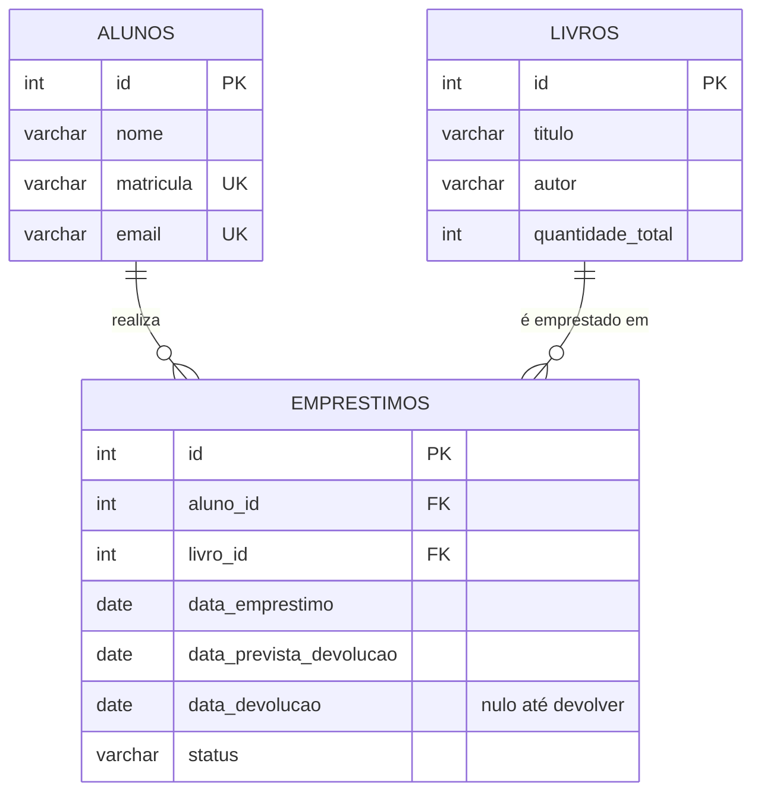

# API de Biblioteca Escolar

> Projeto Final de Backend — API REST
> **Tema:** Educação e Aprendizado

## Integrantes

| Nome | Papel |
|---|---|
| Guilherme Rossa |  |
| Gustavo Rossa |  |
| Filipe | |
| Gabriel | |

## Problema

Bibliotecas escolares costumam controlar empréstimos de livros em planilhas ou cadernos. Isso dificulta saber quais exemplares estão disponíveis, quem está com cada livro e quais devoluções estão atrasadas.

## Domínio e aplicação

API REST para gerenciar o acervo de uma biblioteca escolar: cadastro de alunos e de livros, e registro de empréstimos e devoluções, com controle da quantidade de exemplares disponíveis e dos prazos.

## Tecnologias

_(a definir: linguagem, framework, banco de dados)_

## Diagrama das entidades

> Diagrama gerado no dbdiagram.io.

## Entidades e relacionamentos

- **Aluno**: pessoa que pega livros emprestados. `matricula` e `email` são únicos.
- **Livro**: título do acervo. `quantidade_total` é o número de exemplares que a biblioteca possui.
- **Empréstimo**: registro de que um aluno pegou um livro. `data_devolucao` fica nula até a devolução.

Relacionamentos:
- Um **aluno** tem vários **empréstimos** (1:N).
- Um **livro** aparece em vários **empréstimos** (1:N).
- Na prática, `empréstimos` liga alunos e livros numa relação N:N.

## Regras de negócio iniciais

- Só é possível emprestar um livro se houver exemplar disponível (`quantidade_total` menos os empréstimos ativos). Caso contrário, retorna erro 409.
- `status` do empréstimo: `ATIVO`, `DEVOLVIDO` ou `ATRASADO`.
- Não é possível excluir aluno ou livro que tenha empréstimo vinculado (409).